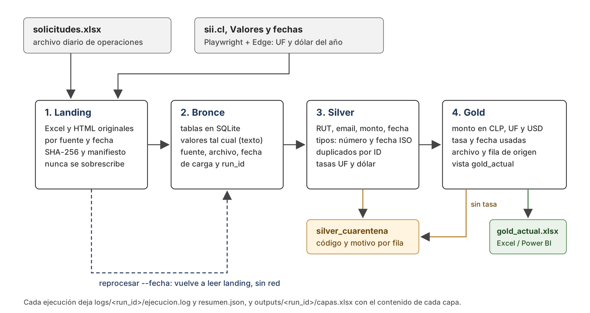

# Robot de solicitudes CLP a UF y USD (Servicios Andes SpA)

Hoy alguien de operaciones busca la UF y el dólar en el sitio del SII y convierte a mano los montos del Excel diario. Este robot hace ese trabajo: descarga las tablas del SII con un navegador, valida las solicitudes, aparta las que tienen errores con su motivo y deja una tabla final con cada monto en CLP, UF y USD. Cada valor de esa tabla se puede seguir hasta el archivo original del que salió.

Lo hice en Python con Playwright. Es gratis, corre en cualquier Windows con Edge, se versiona en Git y se puede probar con tests automáticos. La parte web es la misma que haría un robot de UiPath: abrir la página del SII en un navegador y leer la tabla.



## Requisitos

- Windows 10 u 11 con Microsoft Edge (viene instalado).
- Python 3.12 (es la versión con la que lo probé; 3.11 o superior debería funcionar).
- Acceso a https://www.sii.cl solo para `ejecutar`. El reproceso no usa red.

No se necesitan servicios pagos ni credenciales.

## Instalación

Desde PowerShell, en la carpeta del proyecto:

```powershell
py -3.12 -m venv .venv
.\.venv\Scripts\python.exe -m pip install -r requirements.txt
```

No hace falta descargar navegadores: `config.toml` usa el Edge instalado. Para usar Chromium (por ejemplo en Mac o Linux), dejar `canal = ""` en `[navegador]` y ejecutar `python -m playwright install chromium`.

## Configuración

Todo está en `config.toml`. Las rutas son relativas a ese archivo, así que la carpeta se puede mover sin tocar nada.

| Sección | Qué define |
|---|---|
| `[rutas]` | carpeta de datos (landing), base SQLite, logs y salidas |
| `[entrada]` | nombre de la hoja del Excel |
| `[sii]` | URLs de UF y dólar, con `{anio}` |
| `[navegador]` | canal (Edge), headless, timeout, número de intentos y espera entre reintentos |
| `[negocio]` | zona horaria, días máximos de arrastre del dólar, decimales de UF y USD |

### Credenciales

El proceso no usa credenciales: el SII es público y SQLite es un archivo local. Si la base pasara a PostgreSQL o SQL Server, la clave iría en el Administrador de credenciales de Windows y se leería con `keyring` (o en Orchestrator Assets si esto corriera en UiPath). Nunca en `config.toml` ni en el código.

## Cómo ejecutar

```powershell
# Proceso diario: captura el SII (o reutiliza la captura de hoy) y procesa el Excel
.\.venv\Scripts\python.exe -m rpa_andes ejecutar --entrada solicitudes.xlsx

# Reprocesar una fecha desde landing, sin volver al SII
.\.venv\Scripts\python.exe -m rpa_andes reprocesar --fecha 2026-10-23

# Ver los snapshots guardados
.\.venv\Scripts\python.exe -m rpa_andes snapshots
```

`demo.ps1` corre las tres cosas seguidas (ejecutar, ejecutar de nuevo y reprocesar). Es lo que voy a usar en la presentación. Si Windows no permite ejecutar scripts: `powershell -ExecutionPolicy Bypass -File .\demo.ps1`.

`ejecutar` siempre trabaja con la fecha de hoy en Santiago. En consola se ve el avance y al final se imprime el resumen. El código de salida es 0 si terminó bien (con o sin cuarentena), 1 si hubo un error de sistema y 2 si la configuración o los argumentos están mal. Eso es lo que debería mirar el programador de tareas.

Si en una fecha hay más de un snapshot (llegaron dos Excel distintos el mismo día), `reprocesar` pide `--snapshot` con el ID que muestra `snapshots`.

## Capas

| Capa | Dónde | Qué guarda |
|---|---|---|
| Landing | `data/landing/` | El Excel y las páginas HTML del SII tal como llegaron, en `solicitudes/<fecha>/` y `sii/<fecha>/`. El nombre lleva el inicio del SHA-256 del contenido. Un manifiesto por snapshot (`manifiestos/<fecha>/`) registra qué archivos se usaron, su hash, la URL y la hora de captura. Nada se sobrescribe ni se borra. |
| Bronce | `bronce_solicitudes`, `bronce_tasas` | Las filas del Excel y las celdas de las tablas del SII en columnas, con el valor original como texto (`1.250.000,50`, `14-09-2026`, `39.731,79`). Sin reglas de negocio. Cada fila lleva fuente, archivo de origen, fecha de carga y `run_id`. |
| Silver | `silver_solicitudes`, `silver_tasas`, `silver_cuarentena` | Datos validados y tipados: RUT normalizado (`13433012-0`), email en minúsculas, monto numérico con 2 decimales, fecha ISO. Las filas que no pasan van a cuarentena con código y motivo. |
| Gold | `gold_solicitudes`, vista `gold_actual` | Cada solicitud válida con su monto en CLP, UF y USD, el valor y la fecha de cada tasa usada, los días de arrastre del dólar y los archivos de origen. |

Todo vive en `data/andes.sqlite3`. Para consumir desde Excel o Power BI está `outputs/gold_actual.xlsx`: ruta fija, columnas numéricas y de fecha con su tipo, se actualiza en cada ejecución. Lo armé así porque un CSV con punto decimal se abre mal en un Excel configurado en español de Chile. Si el archivo está abierto en Excel cuando corre el robot, no se puede reemplazar: se deja un aviso en el log y los datos igual quedan en la base.

`gold_actual` muestra la última versión de cada solicitud considerando todos los días procesados. Así, si una solicitud quedó en cuarentena porque faltaba el dólar y al día siguiente se resuelve, aparece en gold sin duplicarse.

## Reglas y supuestos

### Validaciones (bronce a silver)

| Campo | Regla | Código si falla |
|---|---|---|
| Todos | obligatorio, no vacío | `CAMPO_VACIO` |
| RUT | con o sin puntos y guion; dígito verificador módulo 11 | `RUT_INVALIDO` |
| Email | sintaxis `usuario@dominio.tld`; se quitan espacios y se pasa a minúsculas | `EMAIL_INVALIDO` |
| Monto_CLP | número de Excel o texto chileno (`1.250.000,50`, `$ 980.000`); mayor a cero | `MONTO_INVALIDO` |
| Fecha_Solicitud | fecha de Excel o texto `AAAA-MM-DD`, `AAAA/MM/DD`, `DD-MM-AAAA`, `DD/MM/AAAA`; debe existir y no ser posterior al día de proceso | `FECHA_INVALIDA` |
| ID_Solicitud | duplicado idéntico: se conserva la primera fila | `ID_DUPLICADO` |
| ID_Solicitud | mismo ID con datos distintos: todas las filas a cuarentena | `ID_CONFLICTO` |

Una fila puede tener varios motivos y se informan todos. En el caso de `ID_CONFLICTO` (SOL-1006 aparece dos veces con montos distintos) no hay forma de saber cuál es la correcta. Elegir una sería inventar, así que ambas quedan en cuarentena para que el área de origen lo resuelva. La fila completamente vacía del Excel no es una solicitud y no se cuenta.

No se verifica que el RUT exista ni que el email reciba correo. Solo formato.

### Qué dólar usar cuando no hay valor

El dólar observado no se publica sábados, domingos ni feriados. Para esos días uso el último valor publicado antes de la fecha de la solicitud, con un máximo de 7 días corridos (configurable). En el archivo, SOL-1005 (sábado 05-09) usa el viernes 04-09 y SOL-1016 (sábado 19-09) usa el jueves 17-09, porque el 18 fue feriado. Gold guarda la fecha del dólar usado y los días de arrastre, así que se ve cuándo un valor no es del mismo día.

Hay un caso que no es feriado: que el SII todavía no haya publicado. Si la fecha de la solicitud es posterior al último valor de la tabla, solo arrastro el valor cuando los días entre medio son sábado o domingo. Si hay un día hábil sin valor, no puedo saber si fue feriado o si el SII está atrasado. En ese caso la solicitud va a cuarentena con `TASA_NO_DISPONIBLE` y se resuelve sola en la próxima ejecución, con la tabla al día. Prefiero eso a cargar un valor que puede estar mal.

No uso calendario de feriados. Dentro de la serie no hace falta: si hay un valor publicado después del hueco, el hueco fue feriado o fin de semana. Al final de la serie prefiero esperar a adivinar.

Esto no es teórico. Al 23-10-2026 la tabla anual de dólar del SII llega solo hasta el 01-10. Por eso SOL-1029 (viernes 02-10) y SOL-1030 (sábado 03-10) quedan en cuarentena.

### UF y montos

- La UF se publica todos los días, incluidos feriados, así que se exige la UF de la fecha exacta.
- `Monto_UF = Monto_CLP / UF` y `Monto_USD = Monto_CLP / Dólar`. El cálculo se hace con `Decimal` y redondeo hacia arriba en el medio (ROUND_HALF_UP): 4 decimales para UF y 2 para USD.
- Solo se lee la tabla anual de cada página. Las tablas mensuales repiten los mismos valores.
- Se descargan las páginas del año en curso y, si el Excel trae fechas de otros años, también esas.

## Errores

Separo dos tipos de error, igual que en un REFramework.

Una excepción de negocio es una solicitud con datos malos o sin tasa vigente. Va a `silver_cuarentena`, queda en el log con nivel WARNING (fila, ID, código y motivo) y la ejecución sigue. El estado final es `OK_CON_CUARENTENA`.

Un error de sistema es todo lo que impide confiar en el lote: el SII no responde, la página cambió, el Excel no tiene las columnas esperadas, un archivo de landing fue alterado u otra ejecución está corriendo. La ejecución termina en `ERROR_SISTEMA` con código de salida 1 y no publica nada. Lo que ya estaba en la base no se toca, porque la carga de cada snapshot es una sola transacción.

Reintentos: ante timeout, errores de red o proxy (`net::ERR_*`) y respuestas HTTP 408, 429 o 5xx, el robot reintenta hasta `intentos` veces, esperando `espera_inicial_s` y duplicando la espera cada vez (2 s y 4 s con la configuración entregada). Un error de certificado o un HTTP 404 no se reintentan, porque repetir no los arregla.

Si el SII cambia la página, el parser falla antes de cargar nada. Revisa los títulos, el año, que exista una sola tabla anual con cabecera `Día, Ene … Dic`, que estén los 31 días en orden y que cada valor tenga formato `39.731,79`. La página que llegó queda en landing para poder revisarla, pero no se publica como snapshot, así que la siguiente ejecución vuelve a intentar.

## Idempotencia y reproceso

La unidad de trabajo es el snapshot: un Excel en una fecha de extracción (ID `2026-10-23_<hash del Excel>`).

- Si `ejecutar` corre dos veces el mismo día con el mismo Excel, la segunda vez encuentra el manifiesto, no vuelve al SII y recalcula sobre los mismos archivos. Bronce se inserta una sola vez por snapshot (conserva el `run_id` de la carga original). Silver y gold del snapshot se borran y se vuelven a escribir dentro de la misma transacción. No se duplica nada en ninguna capa.
- `reprocesar --fecha` busca el manifiesto de esa fecha, verifica el SHA-256 de cada archivo de landing y reconstruye bronce, silver y gold sin red. Si alguien modificó un archivo de landing, el reproceso se detiene.
- Un archivo de bloqueo (`data/.lock`) impide dos ejecuciones a la vez.

Una consecuencia de esto: si el SII se actualiza a mediodía, una segunda ejecución ese mismo día no lo ve, porque reutiliza la captura de la mañana. Lo dejé así a propósito, porque la captura es la foto del día. Lo que quedó pendiente se resuelve en la ejecución del día siguiente.

## Trazabilidad

Desde cualquier fila de gold se llega al archivo original:

- `archivo_origen` y `fila_origen`: el Excel en landing y la fila exacta.
- `archivo_uf` y `archivo_usd`: la página del SII en landing de la que salió cada tasa.
- `snapshot_id`: el manifiesto con los hashes, la URL y la hora de captura.
- `run_id`: la carpeta `logs/<run_id>/` con el log y el resumen de la ejecución que la calculó.

Por ejemplo, para SOL-1003:

```sql
SELECT g.id_solicitud, g.monto_uf, g.valor_uf, g.archivo_uf,
       g.archivo_origen, g.fila_origen, b.monto_clp AS monto_original, s.manifiesto
FROM gold_solicitudes g
JOIN bronce_solicitudes b USING (snapshot_id, fila_origen)
JOIN snapshots s USING (snapshot_id)
WHERE g.id_solicitud = 'SOL-1003';
```

## Logs y resumen

Cada ejecución crea `logs/<run_id>/` con:

- `ejecucion.log`: inicio, cada etapa con sus conteos (landing, bronce, silver, gold, carga), una línea por cada excepción de negocio y el detalle completo de cualquier error de sistema.
- `resumen.json`: estado, registros leídos, válidos, en cuarentena y cargados en gold, cuarentena por código, rango de fechas de las tasas y ruta de las salidas.

Y `outputs/<run_id>/capas.xlsx` con una hoja por capa (bronce, silver, cuarentena y gold) para revisar el resultado sin abrir SQLite.

## Evidencia incluida

Corrí `demo.ps1` el 23-10-2026 con Edge contra el sitio real del SII: una ejecución que captura, la misma ejecución repetida y un reproceso de la fecha. En la entrega quedan:

- `data/landing/`: el Excel y las dos páginas del SII tal como llegaron, con su manifiesto.
- `data/andes.sqlite3`: todas las capas.
- `logs/<run_id>/`: las tres ejecuciones, cada una con `ejecucion.log` y `resumen.json`.
- `outputs/<run_id>/capas.xlsx` con el contenido de cada capa, y `outputs/gold_actual.xlsx`.

Resultado: 30 solicitudes leídas, 19 válidas, 17 en gold y 13 en cuarentena. La repetición no volvió al SII y no cambió ningún conteo. El reproceso dejó los mismos montos.

| Fila | Solicitud | Código | Motivo |
|---|---|---|---|
| 7 y 30 | SOL-1006 | `ID_CONFLICTO` | mismo ID con montos distintos (1.980.000 y 2.050.000) |
| 8 | SOL-1007 | `RUT_INVALIDO` | dígito verificador 1, debería ser 0 |
| 9 | SOL-1008 | `EMAIL_INVALIDO` | `tomas.silva.correo.cl`, sin @ |
| 10 | SOL-1009 | `MONTO_INVALIDO` | monto negativo |
| 18 | SOL-1017 | `CAMPO_VACIO` | sin monto |
| 20 | SOL-1019 | `CAMPO_VACIO` | sin RUT |
| 21 | SOL-1020 | `MONTO_INVALIDO` | "un millón" |
| 24 | SOL-1022 | `MONTO_INVALIDO` | monto cero |
| 25 | SOL-1023 | `FECHA_INVALIDA` | 31-09-2026 no existe |
| 29 | SOL-1002 | `ID_DUPLICADO` | copia exacta de la fila 3 |
| 31 | SOL-1029 | `TASA_NO_DISPONIBLE` | el SII no ha publicado el dólar del 02-10 |
| 32 | SOL-1030 | `TASA_NO_DISPONIBLE` | ídem, sábado 03-10 después de un viernes sin dato |

Algunas filas tienen formatos raros pero son válidas y pasan: SOL-1010 (`1.250.000,50` como texto), SOL-1011 (`$ 980.000`), SOL-1012 y SOL-1013 (fechas como texto en dos formatos), SOL-1004 (RUT sin puntos ni guion), SOL-1024 (email con espacios y mayúsculas) y SOL-1018 (apellido con apóstrofo).

## Pruebas

```powershell
.\.venv\Scripts\python.exe -m unittest discover -s tests -v
```

43 pruebas, sin red. Usan las páginas reales del SII guardadas en `tests/fixtures/` y el `solicitudes.xlsx` entregado:

- `test_transform.py`: cada validador, varios motivos por fila, duplicados y conflictos, lectura del Excel con su fila vacía.
- `test_sii.py`: lectura de las tablas de UF y dólar, fallos ante cambios de estructura, la regla del dólar (fin de semana, Fiestas Patrias, SII atrasado, máximo de días) y los reintentos del navegador simulado.
- `test_pipeline.py`: ejecución completa con conteos y montos, trazabilidad hasta landing, repetición sin duplicar, reproceso sin red, landing alterado, SII caído, página cambiada, ejecución concurrente y la solicitud que se resuelve al día siguiente.

## Para llevarlo a producción

- Programarlo en el Programador de tareas de Windows o en Orchestrator, en un horario en que el SII ya haya publicado, y alertar por correo cuando el código de salida sea 1.
- Avisar también cuando haya solicitudes con `TASA_NO_DISPONIBLE` por más de un día: es señal de que el SII dejó de actualizar.
- Si el atraso del SII se repite (pasó en octubre de 2026), sumar como respaldo la serie de dólar observado del Banco Central, que es de donde sale el dato que publica el SII. No lo incluí porque el enunciado define al SII como fuente y no quiero mezclar fuentes sin acordarlo antes. Si se agrega, la página del Banco Central tiene que quedar en landing igual que la del SII y cada solicitud en gold debe indicar de qué fuente salió su dólar.
- Mover la base a un servidor (PostgreSQL o SQL Server) si la van a leer varias personas, con la clave en un gestor de credenciales.
- Landing en un almacenamiento con respaldo y retención. Hoy la inmutabilidad la garantiza el código; en producción la daría el almacenamiento.
- Conectar Power BI a `gold_actual` directamente en la base en vez del Excel.

## Estructura

```
config.toml            configuración
demo.ps1               ejecutar, repetir y reprocesar (para la presentación)
solicitudes.xlsx       archivo de entrada entregado
rpa_andes/
  sii.py               extracción web (Playwright), lectura de tablas y regla de tasas
  transform.py         lectura del Excel y validaciones
  landing.py           archivos originales, hashes y manifiestos
  storage.py           tablas SQLite, carga transaccional y exportación a Excel
  pipeline.py          orquestación, logs y resumen
  config.py            lectura de config.toml
  __main__.py          línea de comandos
tests/                 pruebas y páginas del SII guardadas
docs/                  diagrama de arquitectura
data/                  landing y base SQLite de la ejecución de evidencia
logs/, outputs/        logs, resúmenes y Excel de cada ejecución
```
